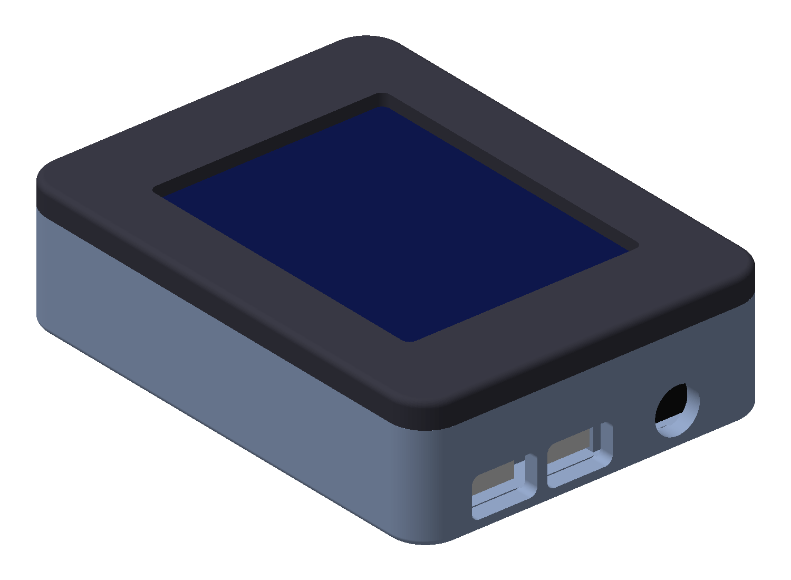

# HolyMP3

A pocket ESP32-S3 handheld: MP3 player, WiFi tool and game player, with a 2.8" touchscreen.



## Hardware
- ESP32-S3 N16R8 dev board (both USB-C ports exposed)
- 2.8" SPI TFT with touchscreen and built-in full-size SD card reader on its side (ILI9341-style module)
- PCM5100/PCM5102A I2S DAC with 3.5 mm headphone jack
- Wiring on a 70 x 30 mm perfboard
- Powered over USB-C (no battery in this revision)

## Case (r3)
- 92.2 x 68.2 x 24.8 mm, two parts: back shell + front bezel
- Print in PLA without supports: shell open side up, bezel face down; 0.2 mm layers, 3 walls, 20% infill
- Case: 4x M2 x 8 mm pan-head self-tapping screws from the back (flush in counterbores)
- Screen: 4x M3 x 5 mm screws through the TFT's mounting holes into bezel standoffs (heat-set M3 inserts are a drop-in upgrade)
- USB-C x2 and the 3.5 mm jack on one end; full-size SD slot (26 x 4 mm) with a finger recess on the other
- Assembly: bezel face down, screw the TFT onto the standoffs, place the perfboard/DAC, close with the shell

| Folder | Contents |
|---|---|
| `stl/` | Print-ready meshes |
| `step/` | STEP for each part + assembly |
| `cad/` | Parametric CadQuery source (`case.py`); all dimensions in one block at the top |
| `images/` | Renders |

**Fit notes:** component dimensions are typical values, not measured. Read [FIT.md](FIT.md) and adjust the parameter block in `cad/case.py` to your boards before printing. The screen window position has the least margin. Print the shell alone first as a fit test.

## Rebuild
```bash
pip install cadquery
python cad/case.py out/
```

## Roadmap
- Battery version (LiPo + USB-C charger, about 8 mm taller)
- Pinholes for BOOT/RESET once button positions are measured

## Changelog
- r3: M2 case screws, M3 screen mounting, full-size SD slot, fixed the r2 SD recess that cut through the wall, thicker bezel face (24.8 mm total)
- r2: first published version
- Firmware

## License
- Code (`cad/*.py`): [MIT](LICENSE)
- 3D models, renders and docs (`stl/`, `step/`, `images/`, `*.md`): [CC BY 4.0](LICENSE-CC-BY-4.0.txt). You can share and adapt them, including commercially, as long as you credit "HolyMP3 by nsumia" and link this repo.
